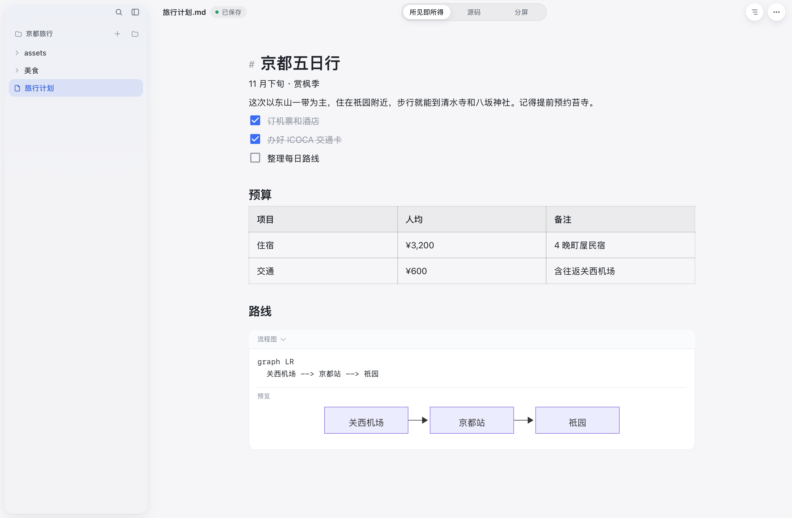

# MarkCune 编辑器

[](https://github.com/wan9x1aomao/markcune/actions/workflows/ci.yml)

MarkCune（原 MDPad 编辑器）是一款轻量、免费的本地 Markdown 编辑器。文稿以标准 Markdown 文件保存在本机，编辑和保存可离线完成。AI 与语音转写只会把相关内容发送到你配置的服务，MarkCune 不做中转。

**[官网与下载](https://wsmknows.top/markcune/)** ｜ [GitHub Release](https://github.com/wan9x1aomao/markcune/releases/latest) ｜ MIT ｜ macOS / Windows / Linux



## 下载

- [macOS（Apple 芯片）](https://github.com/wan9x1aomao/markcune/releases/latest/download/MarkCune-macOS-arm64.dmg)
- [Windows](https://github.com/wan9x1aomao/markcune/releases/latest/download/MarkCune-windows-x64-setup.exe)
- [Linux AppImage](https://github.com/wan9x1aomao/markcune/releases/latest/download/MarkCune-linux-x86_64.AppImage)
- [Linux `.deb`](https://github.com/wan9x1aomao/markcune/releases/latest/download/MarkCune-linux-amd64.deb)

| 平台 | 要求 |
| --- | --- |
| macOS | 13 及以上，Apple 芯片 |
| Windows | 10 / 11，系统自带 WebView2 |
| Linux | WebKitGTK 4.1 |

4.0.5 及更早版本需要手动安装一次当前版本。4.0.6 及以后可从 GitHub Release 检查更新。设置、AI Key、草稿和书库会保留。macOS 如果仍有旧的 `MDPad.app`，建议先删除再安装 DMG。

## 主要功能

- 所见即所得、源码和分屏编辑，支持 Markdown、代码高亮、LaTeX 与 Mermaid
- 自动保存，草稿重启后恢复
- 大段误删时先提示撤销或立即保存，支持恢复上次自动保存版本
- AI 续写、改写和逐段审阅，只有点击「采纳」才会写入文档
- 文件与大纲支持多种布局，偏好自动记住
- 从链接导入 GitHub 书库和文章，图片可随文档保存
- 导出单文件网页、Word、PDF 和 PNG 长图
- 语音输入，录音在本机完成后发送给指定识别服务

## 开发

需要 **Node 22+**、**Rust stable**。Linux 还需要 WebKitGTK 等依赖：

```bash
sudo apt install -y libwebkit2gtk-4.1-dev libayatana-appindicator3-dev \
  librsvg2-dev libxdo-dev libssl-dev patchelf
```

```bash
npm install
npm run dev          # Tauri 开发模式
npm run dev:web      # 只启动前端
npm run build        # 构建当前平台
```

Windows 和 Linux 安装包由 `.github/workflows/build.yml` 构建。

## 测试

```bash
npm test
npm run test:browser
(cd src-tauri && cargo test)
```

界面冒烟测试需要联网，Windows 使用 `tests/smoke/run.ps1`，Linux 使用 `tests/smoke/run.sh`。

## 发版维护

```bash
KEEP_RELEASE=1 scripts/release.sh <版本号> "更新说明"
```

发版需要已登录的 `gh` 和 `~/.tauri/mdpad.key`。脚本会在本机构建 macOS 包，触发 GitHub Actions 构建 Windows / Linux 包，并把固定文件名和 `latest.json` 上传到草稿 Release。确认资产后发布：

```bash
gh release edit v<版本号> --draft=false
```

官网源码位于 `/Users/wsm/markcune-web`。发布后在官网仓库执行 `npm run build`、`npm run check`、`npm run pack`，再按服务器部署流程切换正式版本。

## 目录

```text
src/             前端
src-tauri/       Rust 外壳
gateway/         「一键整理」网关参考实现
scripts/         构建与发版脚本
tests/           单测、浏览器和冒烟测试
```

## 许可证

[MIT](LICENSE)。第三方组件及许可正文见 [THIRD-PARTY-NOTICES.md](THIRD-PARTY-NOTICES.md)，应用内「设置 › 关于 › 开源许可」显示同一份内容。

欢迎提交 issue 和 PR。提交前请运行 `npm test` 和 `cargo test`。
