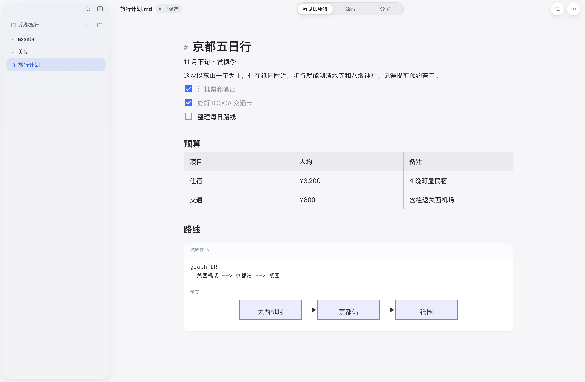

# MDPad

[](https://github.com/wan9x1aomao/mdpad/actions/workflows/ci.yml)

轻量、免费的本地 Markdown 编辑器。打开就能写字，写下的每个字都留在你自己的硬盘上 —— 不登录、不联网、不上传。



## 下载

安装包在官网：**<https://mdpad.app.workbuddy.host/>**

| 平台 | 要求 |
|---|---|
| macOS | 13 及以上（Apple 芯片） |
| Windows | 10 / 11，使用系统自带的 WebView2 |
| Linux | 需要 WebKitGTK 4.1（`.deb` 与 `.AppImage` 都提供） |

历史版本按 [`v3.2.1` → `v3.3.5`](https://github.com/wan9x1aomao/mdpad/tags) 打了 tag，每个 tag 就是那个版本的源码快照。

## 功能

- **所见即所得，也能看源码** —— Markdown 一输入就排好版；`⌘/` 切到源码，`⌥⌘/` 分屏对照
- **文件夹 · 大纲 · 命令面板** —— 打开整个文件夹，左边文件、右边大纲；`⌘P` 快速打开，`⌘K` 命令面板
- **一键整理格式** —— 随手写下的纯文本，一键分出标题、列表和引用。只重排结构，文字一个字都不改，一步撤销即可回到原样
- **粘贴链接，整本书到手** —— GitHub 上的书，把链接粘进来就下载到本地书库，图片和章节之间的跳转一起带走，断网也能读
- **自动保存，不丢稿** —— 停笔一秒自动保存，草稿重启后恢复；文件被外部改动时先提醒，不会覆盖
- **代码、公式、流程图** —— 代码高亮与一键复制，LaTeX 公式，Mermaid 流程图实时渲染
- **图片跟着文档走** —— 粘贴或拖入图片自动存进 `assets`，另存到别处时一起迁移
- **轻巧** —— 系统原生 WebView，不内置浏览器；源码、公式、流程图、导出都按需加载

## 开发

需要 **Node 22+** 和 **Rust**（stable）。Linux 还要装 WebKitGTK 等系统依赖：

```bash
# 只在 Linux 上需要
sudo apt install -y libwebkit2gtk-4.1-dev libayatana-appindicator3-dev \
                    librsvg2-dev libxdo-dev libssl-dev patchelf
```

```bash
npm install
npm run dev        # 开发模式（tauri dev）
npm run dev:web    # 只在浏览器里调前端（vite）
```

打包：

```bash
npm run build       # macOS：src-tauri/target.noindex/release/bundle/macos/MDPad.app
npm run build:win   # Windows：NSIS 安装包
```

Linux 的 `.deb` / `.AppImage` 与 Windows 的 `.exe` 由 GitHub Actions 构建（`.github/workflows/build.yml`）。

## 测试

```bash
npm test                                   # 前端逻辑单测（整理、网关协议、下载回执）
(cd src-tauri && cargo test)               # Rust 单测（文件操作、链接识别、解压）
npx tauri build --debug --no-bundle
tests/smoke/run.sh                         # 冒烟测试；Windows 上用 tests/smoke/run.ps1
tests/scenarios.sh                         # 文件操作场景，仅 macOS
```

⚠️ 冒烟测试会真的去 GitHub 下载一个仓库来验证「从链接打开」，需要联网。

## 自动更新

更新地址在**打包时**通过 `MDPAD_UPDATE_ENDPOINT` 注入（`src-tauri/src/update.rs` 用 `option_env!` 读取）。不设这个变量编出来的包不会检查更新，从源码自己构建可以直接用。签名公钥写在 `src-tauri/tauri.conf.json`，私钥不进仓库。

## 一键整理的网关（可选）

「一键整理」不配 AI 也能用 —— 那时只做规则整理。想要更好的排版判断，可以自己跑一个网关：`gateway/` 里是一个零依赖的参考实现，接口约定见 [`docs/tidy-gateway.md`](docs/tidy-gateway.md)。应用只把原始行发过去、拿回每行的标签，文字始终由应用自己拼，所以网关改不了也丢不了用户的原话。

## 发版（维护者）

```bash
scripts/release.sh <版本号> "更新说明"
```

本地打 macOS 包 → 触发 GitHub Actions 打 Windows / Linux → 收产物、生成 `latest.json`、更新官网目录。需要签名私钥（`~/.tauri/mdpad.key`）和已登录的 `gh`，配置写在 `scripts/release.conf`。**这个脚本只服务于本仓库的发布流程，不是安装或构建 MDPad 的方式**；从源码构建请用上面的 `npm run build`。

## 目录

```
src/             前端（Milkdown Crepe + CodeMirror，原生 JS 无框架）
src-tauri/       Rust 外壳（窗口、文件、草稿、下载、更新）
gateway/         「一键整理」网关的参考实现
scripts/         图标、DMG、发布脚本
tests/           单测与冒烟 / 场景测试
```

## 许可证

[MIT](LICENSE)。用到的第三方库：Milkdown（MIT）、Tauri（MIT / Apache-2.0）、CodeMirror（MIT）、KaTeX（MIT）、Mermaid（MIT）。

欢迎 issue 和 PR。提 PR 前请先跑一遍 `npm test` 和 `cargo test`。
